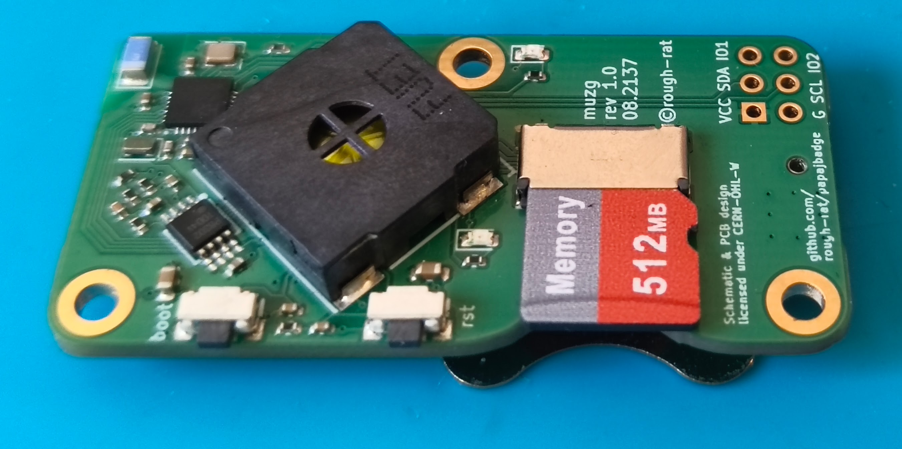
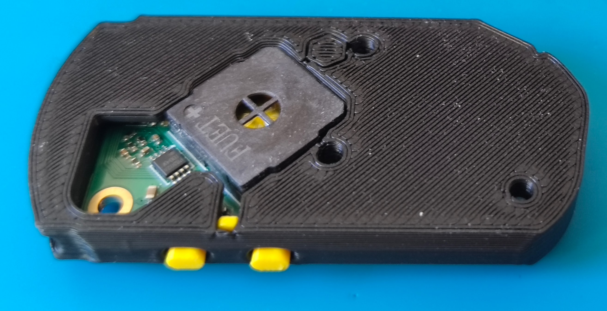
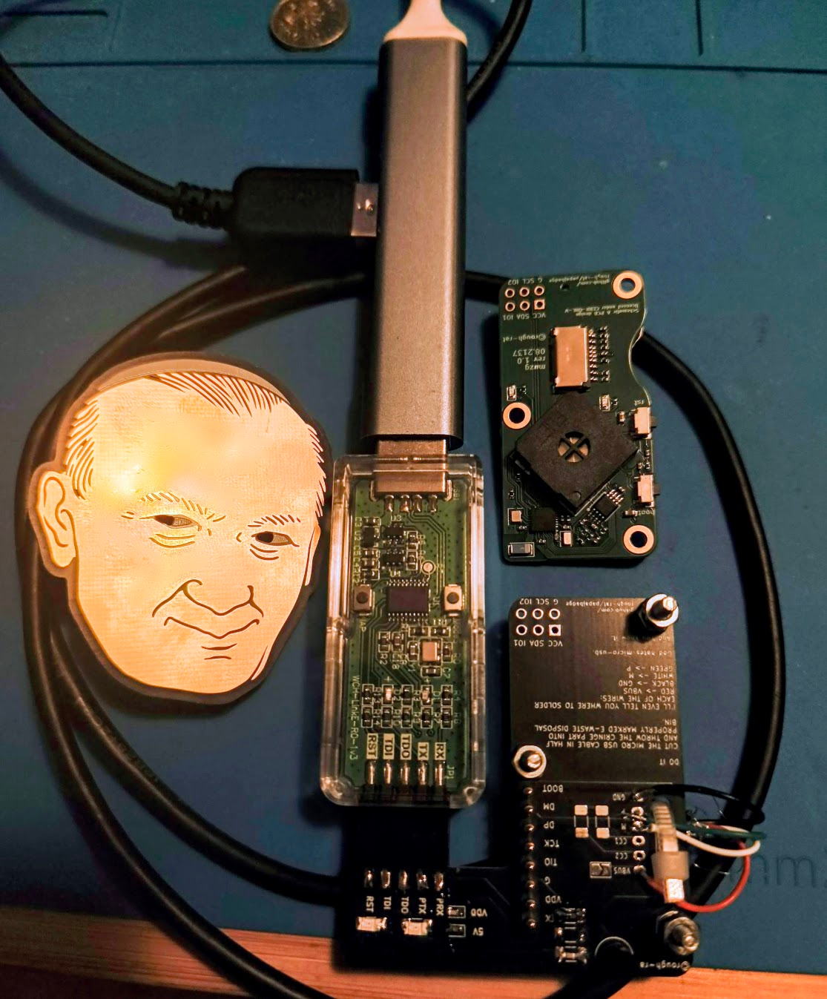
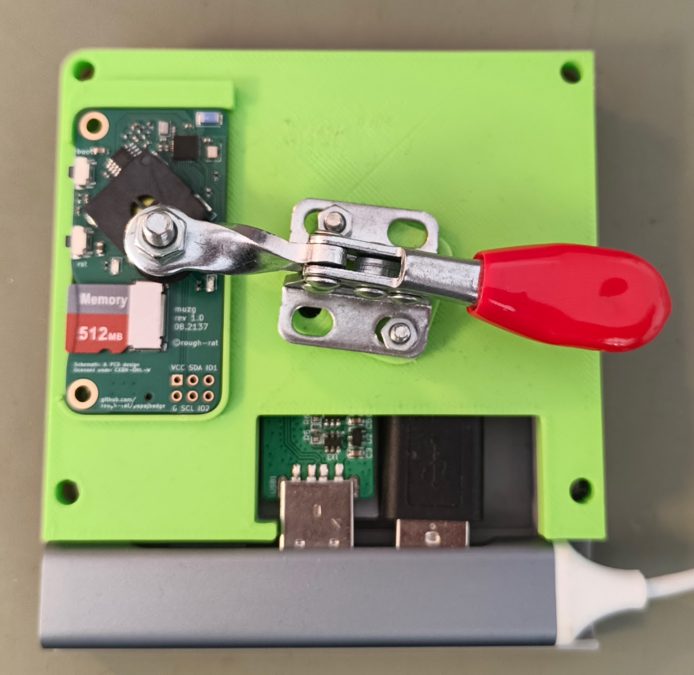
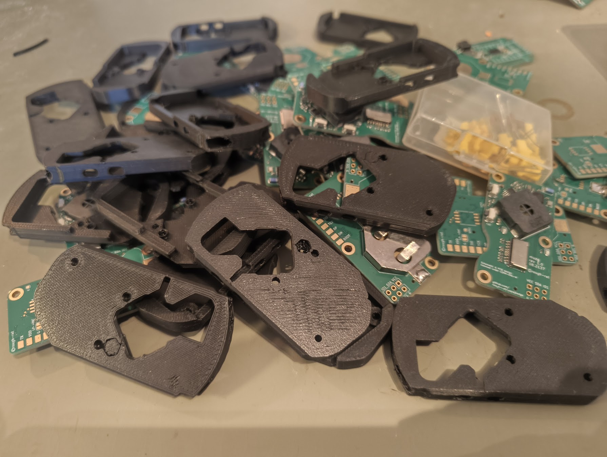

# papajbadge

A badge we made for 2025 Cebulacamp. The design more or less worked, but speaker schematic is botched, and
required some rework. In the end I decided to repurpose these devices for other projects.

*Naked device*

*Device in 3d printed case*

*Development kit, naked, featuring spring loaded pogo pins*

*Assembled programming fixture*

*Stack of unassembled devices*

## License

This repository contains three separately licensed things:

### Hardware — CERN-OHL-W v2

Copyright © 2025 Jakub "critbit" Sadowski.

The electronic design (schematics, PCB layout, routing, and the other design
files in this repository, excluding the artwork and firmware
described below) is Open Hardware, licensed under the CERN Open Hardware
Licence Version 2 - Weakly Reciprocal.
You may redistribute and modify it under the terms of the
[CERN-OHL-W v2](LICENSES/CERN-OHL-W-2.0.txt) (https://ohwr.org/cern_ohl_w_v2.txt).

It is distributed WITHOUT ANY EXPRESS OR IMPLIED WARRANTY, INCLUDING OF
MERCHANTABILITY, SATISFACTORY QUALITY AND FITNESS FOR A PARTICULAR PURPOSE.
Please see the CERN-OHL-W v2 for applicable conditions.

### Artwork — CC BY-NC-SA 4.0

Copyright © 2025 @weasel.

The artwork is licensed separately from the hardware. The drawings in the
`.svg` files, and the same graphics where they appear in the PCB and
fabrication files (silkscreen, copper, solder mask and board outline, including
Gerbers and other manufacturing outputs), are licensed under
[Creative Commons Attribution-NonCommercial-ShareAlike 4.0 International](LICENSES/CC-BY-NC-SA-4.0.txt)
(https://creativecommons.org/licenses/by-nc-sa/4.0/).

Because the artwork is part of the board layout, a badge manufactured from
these files as-is includes it, so the non-commercial and share-alike conditions
apply to such badges. The CERN-OHL-W terms apply on their own only to the design
with the artwork removed or replaced.

### Firmware — MIT

Copyright © 2025 Jakub "critbit" Sadowski and the contributors to
[rough-rat/papajbadge-rs](https://github.com/rough-rat/papajbadge-rs).

The firmware in [`firmware/`](firmware/) is licensed under the [MIT License](LICENSES/MIT.txt).
It was moved from and remains based on contributions to that repository by
[@cr1tbit](https://github.com/cr1tbit),
[@LiquidLemon](https://github.com/LiquidLemon),
[@q3k](https://github.com/q3k), and
[@tym2k1](https://github.com/tym2k1).

### Other licensing

If the licenses above don't fit what you have in mind, for example running
workshops or events with these badges, or making them in larger batches,
get in touch. We're open to licensing this work on different terms.

Visit [roughrat.com](https://roughrat.com) for contact info.

### How to credit

When you share or build on this project, please credit it like this:

> papajbadge: hardware by Jakub "critbit" Sadowski (CERN-OHL-W v2),
> artwork by @weasel (CC BY-NC-SA 4.0),
> firmware by Jakub "critbit" Sadowski and the contributors to
> [rough-rat/papajbadge-rs](https://github.com/rough-rat/papajbadge-rs) (MIT).
